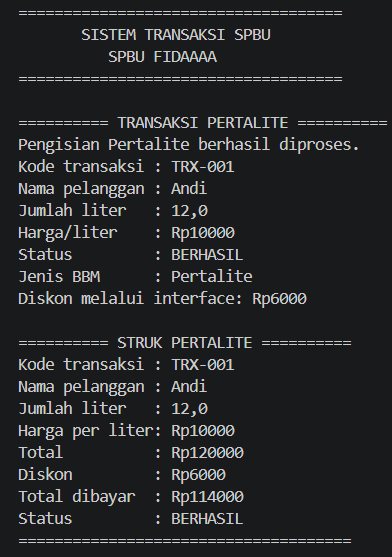
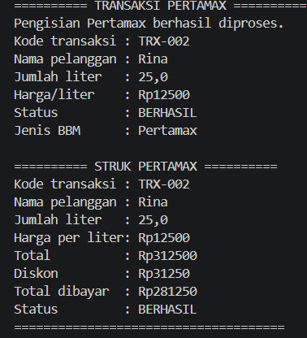
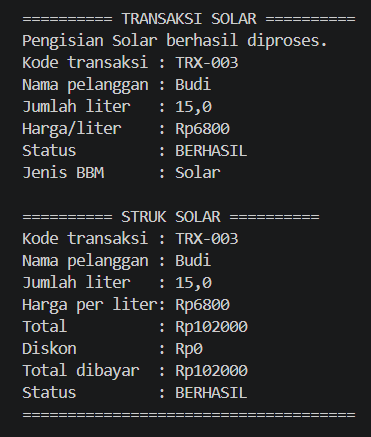
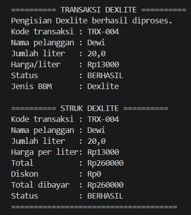
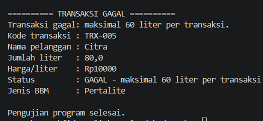

# Sistem Transaksi SPBU 

- Nama: Fida Aulia Afifah
- NIM: H1D0250112
- Shift Awal: F
- Shift Baru: H-I 
- Digit terakhir NIM: 2
- Tema: SPBU

## Deskripsi Program

Sistem Transaksi SPBU merupakan program berbasis Java yang dibuat untuk memenuhi tugas Responsi Akhir Praktikum Pemrograman Berorientasi Objek.

Program ini mensimulasikan proses transaksi pengisian bahan bakar pada SPBU dengan empat jenis bahan bakar, yaitu Pertalite, Pertamax, Solar, dan Dexlite.

Setiap jenis bahan bakar memiliki karakteristik, harga, serta batas pengisian yang berbeda. Program dapat melakukan validasi jumlah pengisian, menghitung total pembayaran, menerapkan diskon sesuai ketentuan, serta menampilkan informasi transaksi dan struk pembayaran.

Program ini dikembangkan dengan menerapkan berbagai konsep Pemrograman Berorientasi Objek (PBO) sesuai dengan ketentuan penugasan.

## Daftar Jenis Bahan Bakar

Program ini menyediakan empat jenis bahan bakar, yaitu:

- Pertalite – memiliki harga dan batas maksimal pengisian tersendiri.
- Pertamax – memiliki harga dan batas maksimal pengisian tersendiri.
- Solar – memiliki harga dan batas maksimal pengisian tersendiri.
- Dexlite – memiliki harga dan batas maksimal pengisian tersendiri.

Setiap jenis bahan bakar memiliki ketentuan harga, batas pengisian, dan perhitungan transaksi yang disesuaikan dengan program.

## Struktur File

- Main.java : Digunakan untuk menjalankan program dan menguji skenario transaksi.
- LayananSPBU.java : Merupakan abstract class yang menjadi superclass bagi class pengisian BBM.
- PengisianPertalite.java : Menangani proses transaksi pengisian Pertalite.
- PengisianPertamax.java : Menangani proses transaksi pengisian Pertamax.
- PengisianSolar.java : Menangani proses transaksi pengisian Solar.
- PengisianDexlite.java : Menangani proses transaksi pengisian Dexlite.
- Diskon.java : Interface yang digunakan untuk mendefinisikan perilaku pemberian diskon,
- CetakStruk.java : Interface yang digunakan untuk mendefinisikan perilaku percetakan struk transaksi.

## Penerapan 10 Persyaratan PBO

Dalam program transaksi SPBU ini, terdapat beberapa konsep pemrograman berorientasi objek yang diterapkan, yaitu:

1. State dan Behavior 
   Menggunakan atribut untuk menyimpan data transaksi serta method untuk menjalankan proses transaksi.

2. Immutability
   Menggunakan `public static final` sebagai konstanta dan `private final` pada atribut yang nilainya tidak dapat diubah.

3. Enkapsulasi dan Overloading
   Menggunakan atribut `private`, getter, setter, keyword `this`, serta beberapa konstruktor dengan parameter berbeda.

4. Inheritance 
   Program menggunakan `LayananSPBU` sebagai superclass yang diwariskan oleh class `PengisianPertalite`, `PengisianPertamax`, `PengisianSolar`, dan `PengisianDexlite` melalui keyword `extends`.

5. Super Chaining  
   Menggunakan `super()` untuk memanggil konstruktor superclass dan `super.namaMethod()` untuk memanggil method dari superclass.

6. Method Overriding 
   Menggunakan `@Override` pada subclass untuk menyesuaikan implementasi method dari superclass.

7. Abstract Class
   Menggunakan `LayananSPBU` sebagai abstract class yang memiliki abstract method `prosesTransaksi()`.

8. Logika State Percabangan
   Menggunakan percabangan `if/else` untuk memeriksa jumlah liter dan menentukan status transaksi.

9. Polimorfisme Interface 
   Memanggil method objek melalui variabel bertipe interface, seperti `Diskon` dan `CetakStruk` di dalam `Main.java`.

10. Multiple Interface
    Menggunakan dua interface sekaligus pada subclass tertentu, yaitu `Diskon` dan `CetakStruk`.

   
## Dokumentasi Output Progam

Berikut merupakan dokumentasi hasil output program Sistem Transaksi SPBU yang dijalankan melalui terminal:

1. Transaksi Pertalite
   Screenshot berikut menampilkan hasil transaksi pengisian BBM Pertalite beserta informasi pembayaran dan struk transaksi. 
   

2. Transaksi Pertamax
   Screenshot berikut menampilkan hasil transaksi pengisian BBM Pertamax beserta informasi pembayaran dan struk transaksi.
   

3. Transaksi Solar 
    Screenshot berikut menampilkan hasil transaksi pengisian BBM Solar beserta informasi pembayaran dan struk transaksi.
    

4. Transaksi Dexlite
    Screenshot berikut menampilkan hasil transaksi pengisian BBM Dexlite beserta informasi pembayaran dan struk transaksi.
    

5. Transaksi Gagal
    Screenshot berikut menampilkan hasil transaksi yang gagal karena jumlah pengisian melebihi batas maksimal yang telah ditentukan. 
    