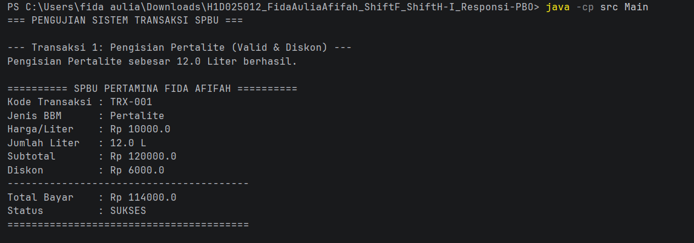
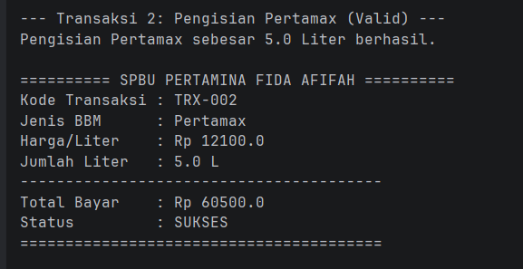
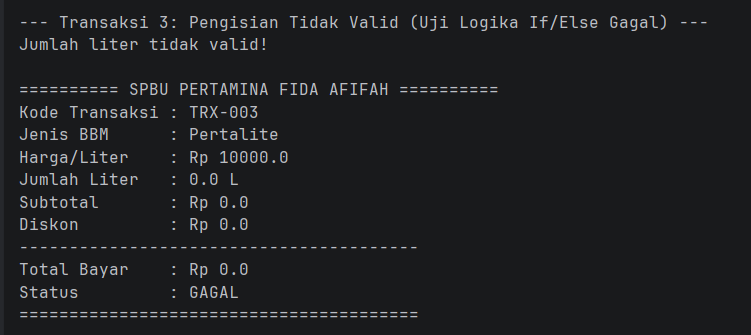
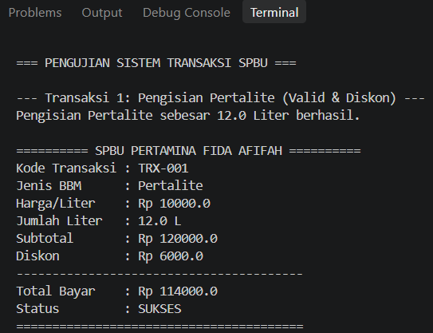
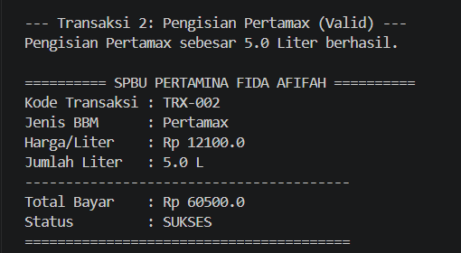
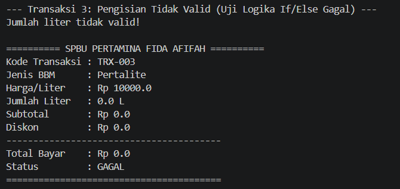
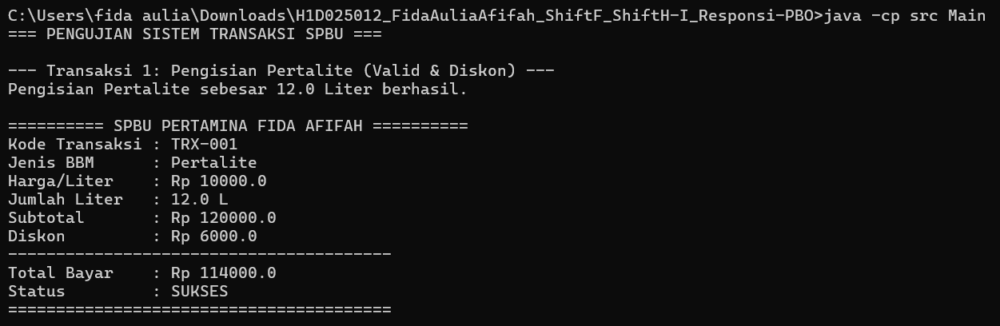
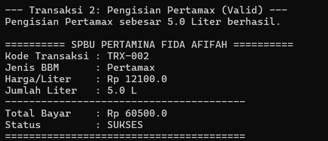
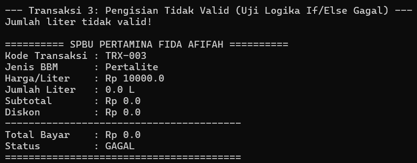

# Sistem Transaksi SPBU 
- Nama: Fida Aulia Afifah
- NIM: H1D025012
- Shift Awal: F
- Shift Baru: H-I 
- Tema: SPBU

## Aplikasi Pengujian (Run Environment)
Untuk memastikan portabilitas dan validasi kode program secara menyeluruh, pengujian eksekusi sistem SPBU ini dilakukan pada 3 aplikasi berbeda:
1. **IntelliJ IDEA**
2. **Visual Studio Code (VS Code)**
3. **Command Prompt / Terminal (CMD)**

## Fungsi Setiap File
- **Main.java** : File eksekusi utama untuk menguji alur dan skenario transaksi SPBU.
- **LayananSPBU.java** : Superclass berbentuk abstract class yang menampung atribut dasar serta aturan transaksi.
- **PengisianPertalite.java** : Subclass pengisian Pertalite yang sudah dilengkapi fitur hitung diskon.
- **PengisianPertamax.java** : Subclass khusus untuk mengolah transaksi pengisian Pertamax.
- **Diskon.java** : Interface penentu aturan kalkulasi diskon belanja.
- **CetakStruk.java** : Interface untuk memformat dan menampilkan cetakan struk transaksi.

### File Tambahan
- **screenshots/** : Folder tempat menyimpan dokumen gambar bukti keluaran (output) program.
- **README.md** : Berkas panduan dan dokumentasi utama repositori.

## Petunjuk Menjalankan Program di Terminal
Buka Terminal/Command Prompt pada folder ini, lalu jalankan 2 perintah berikut:

1. **Kompilasi seluruh file Java:**
   javac src/*.java

2. **Jalankan program utama:**
   java -cp src Main

## Bukti Tampilan Output (Screenshots)

### 1. Pengujian via IntelliJ IDEA

#### Transaksi 1: Pengisian Pertalite (Valid & Diskon)

#### Transaksi 2: Pengisian Pertamax (Valid Tanpa Diskon)

#### Transaksi 3: Pengisian Tidak Valid (Uji Logika If/Else Gagal)

### 2. Pengujian via Visual Studio Code (VS Code)

#### Transaksi 1: Pengisian Pertalite (Valid & Diskon)

#### Transaksi 2: Pengisian Pertamax (Valid Tanpa Diskon)

#### Transaksi 3: Pengisian Tidak Valid (Uji Logika If/Else Gagal)

### 3. Pengujian via Command Prompt (CMD)

#### Transaksi 1: Pengisian Pertalite (Valid & Diskon)

#### Transaksi 2: Pengisian Pertamax (Valid Tanpa Diskon)

#### Transaksi 3: Pengisian Tidak Valid (Uji Logika If/Else Gagal)
